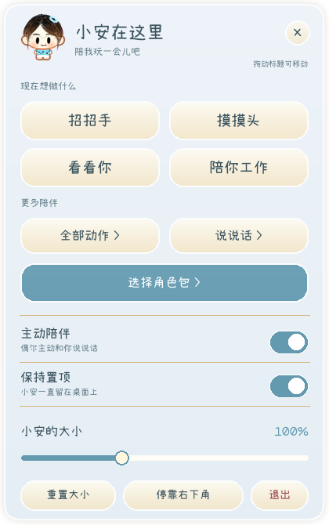
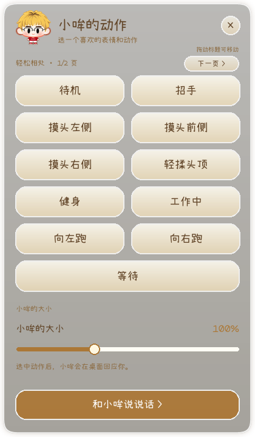

<div align="center">

# Desktop Pet Template

**给 Agent 一张参考图，把你的角色做成可以安装的桌宠。**

可替换角色包 · AI 动作与台词 · 液态玻璃面板 · 鼠标与键盘互动

[](#requirements)
[](#manual)
[](https://github.com/Howltan-Neo/desktop-pet-template/actions/workflows/verify.yml)

[交给 Agent 开始制作](#agent-start) · [完整提示词](docs/agent-prompt.md) · [手动运行](#manual) · [验证记录](docs/validation.md)

</div>

---

这个项目把小安与小哞的 Windows 桌宠整理成了共享运行时。角色形象、动作帧、台词、点击区域、主题色和字体都属于独立角色包，换角色时可以复用同一套程序。

**推荐用法：复制下面的提示词给 Agent，让它先引导你提供参考图，再完成制作、检查、打包与安装。** 你不需要先学会配置 JSON、绘制动画或编写 Python。

> 当前版本为 **0.1.0 验证版**。这是一套由 Agent 执行的制作流程；使用的 Agent 需要具备文件读写、命令执行、生图和看图能力。现有桌宠面板中尚未提供“上传图片后自动制作”的应用内按钮。真实 API 出图质量与每个新角色都需单独验收，详情见[验证记录](docs/validation.md)。

<table>
  <tr>
    <th align="center">小安 · 蓝灰主题</th>
    <th align="center">小哞 · 暖黄主题</th>
  </tr>
  <tr>
    <td align="center"></td>
    <td align="center"></td>
  </tr>
  <tr>
    <td align="center">共享面板与互动逻辑</td>
    <td align="center">按角色配置动作、配色与文案</td>
  </tr>
</table>

## 导航

- [01 · 复制提示词，交给 Agent](#agent-start)
- [02 · 你需要提供什么](#reference)
- [03 · Agent 怎样把图片变成安装包](#workflow)
- [04 · 完成后怎样安装和使用](#install)
- [05 · 环境与 Agent 能力](#requirements)
- [06 · 手动运行与 API 命令](#manual)
- [07 · 角色包、主题与扩展](#customize)
- [08 · 验证范围与素材许可](#validation)

---

<a id="agent-start"></a>
## 01 · 复制提示词，交给 Agent

在支持项目文件和图像工具的 Agent 中打开本项目，或者直接发送以下提示词，让它获取项目。**还没有上传参考图也可以先发送**，Agent 应主动提示你提供图片。

```text
请使用这个项目，为我制作并安装一个可独立运行的 Windows 桌宠：
https://github.com/Howltan-Neo/desktop-pet-template

先在已授权工作区获取或打开项目，读取 README.md、AGENTS.md 和
docs/agent-prompt.md，按完整任务书执行，而不只给我计划或素材。

如果我还没有提供参考图，请先引导我上传一张角色图片，或者提供本机图片路径。
角色名称、性格、主题色和其他偏好均可选；未指定时从图片提出合理的默认方案，
不要重复进行完整问卷。已有参考图时直接使用。

沿用现有的角色主题色、液态玻璃面板与附带字体风格，允许我提出自定义设计。
先识别不可改变的形象特征，制作一张基准预览给我确认，再批量设计动作、表情、
独立动作帧和符合性格的中文台词。配置新角色的点击热区与键鼠互动。

完成逐帧总览、GIF、结构检查、视觉审查及定点修复，然后构建完整便携版和安装器。
同步设置新角色的默认启动入口、图标、应用名称和独立安装标识，确保安装后显示我的角色。
按本机权限和我的授权完成安装与真实 Windows 检查，交付成品、源码、使用说明和验证记录。

优先使用宿主已有的图像工具。需要额外付费、配置密钥或系统授权时，清楚说明原因；
已有授权不要重复询问。若缺少某项能力，说明具体缺项，继续能完成的部分，
不要把占位图、模拟测试或未执行的检查当成最终完成。

请现在开始；如果还没有参考图，先提示我提供一张图。
```

更详细的动作、修复、安装和交付约束已经写在 **[完整版 Agent 提示词](docs/agent-prompt.md)** 中，可直接整段复制；[AGENTS.md](AGENTS.md) 为进入仓库的 Agent 提供相同方向的执行规则。

**获取项目的三种方式：**

| 方式 | 操作 |
| --- | --- |
| 让 Agent 获取 | 发送上面的仓库链接与提示词，由 Agent 在授权工作区准备项目 |
| 建立自己的副本 | GitHub 页面点击 **Use this template → Create a new repository**，再让 Agent 打开自己的仓库 |
| 直接下载 | 点击 **Code → Download ZIP**，解压后让 Agent 打开解压目录 |

<a id="reference"></a>
## 02 · 你需要提供什么

**通常只需要一张参考图。** 手绘、插画或清晰照片均可作为起点。主体完整、五官和衣服可辨认，会更容易保留形象；不要求你预先画好透明底、动作帧或精灵图集。

| 信息 | 是否必填 | 未提供时怎样处理 |
| --- | --- | --- |
| 参考图或本机图片路径 | 必需 | Agent 先提示你提供，并等待图片 |
| 角色名称 | 可选 | Agent 提出名称并生成独立角色 ID |
| 性格与说话方式 | 可选 | 默认采用友好、简短、符合形象的中文台词 |
| 主题色与字体 | 可选 | 从图片提取配色，沿用现有玻璃面板与附带字体 |
| 特别动作或互动部位 | 可选 | 先制作通用动作；有耳朵、发尾、尾巴等再加对应互动 |
| 安装位置与分发名称 | 可选 | Agent 先给出建议，依照你的授权和本机规则安装 |

只有头像也可以开始：Agent 需要把身体和服装等未画出的部分明确当作补充设计，并在基准预览中给你看，不能声称这些细节来自原图。

> “一张图开始”不等于零参与。你仍可能需要确认基准形象、处理系统权限，或决定额外付费调用。无需你逐项手工安排每帧动作、配置目录或编写代码。

<a id="workflow"></a>
## 03 · Agent 怎样把图片变成安装包

**参考图 → 形象约束 → 基准预览 → 动作与台词 → 检查修复 → Windows 程序 → 安装验收**

| 阶段 | Agent 负责完成 | 你会看到的结果 |
| --- | --- | --- |
| 准备 | 阅读仓库、检查 Python / 图像工具 / Windows 构建能力，引导补齐参考图 | 环境与能力说明 |
| 识别形象 | 记录五官、发型、服装、配饰、比例和不可随意改变的特征 | 角色约束与制作任务书 |
| 锁定基准 | 根据原图制作完整透明底待机帧 | 一张供你确认的基准预览 |
| 设计动作 | 安排动作相位、表情和细节，绘制独立帧，生成中文台词 | 角色包与动作循环 |
| 检查修复 | 检查完整性、角色一致性、动作衔接、透明边缘、基线和热区 | 逐帧总览、GIF、问题与修复记录 |
| 构建 | 配置默认角色、应用图标、安装标识，生成便携版与安装器 | 可运行程序与安装包 |
| 验收安装 | 运行打包程序，检查交互、安装和退出，依授权安装正式副本 | 使用说明、版本、哈希及验收记录 |

### 默认动作和互动

| 类别 | 默认内容 |
| --- | --- |
| 日常状态 | 待机、招手、等待、失落、工作、沉思、睡觉、伸懒腰、打哈欠、蹭蹭 |
| 触摸反应 | 左 / 前 / 右侧摸头、轻揉头顶；按角色加入发尾、耳朵、尾巴等互动 |
| 移动与视线 | 左右跑步、16 方向头部和脸部朝向 |
| 文案 | 为各动作生成至少四条短句，符合角色性格，同一轮避免重复 |
| 桌面功能 | 拖动、置顶、缩放、托盘、主动陪伴、任务栏避让与对白避让 |

计划工具预设 **17 个动作、116 个输出帧位置**，通用动作通常 6 帧、左右跑步 8 帧、方向视图 16 帧。动作清单与帧数均可调整；这只是制作计划，运行计划命令不会自动获得成品动画。

动作必须包含有意义的姿态变化。检查时要看人物是否同一个、手脚是否完整、衣服和配饰是否稳定、跑步摆臂与落脚是否合理，以及首尾是否能自然连接。**结构检查通过、AI 说“通过”和人的视觉验收是三个不同的结果。**

<a id="install"></a>
## 04 · 完成后怎样安装和使用

### 应当拿到什么

- **安装器**：完成 Inno Setup 构建后生成的安装程序，可按提示安装并正常卸载。
- **完整便携目录**：程序 EXE 及其 `_internal` 等依赖目录，一起保留才能运行。
- **角色包与可编辑源码**：后续换主题、改台词、增加动作或继续修复时使用。
- **动作预览和验证记录**：包括实际执行的检查、版本、SHA-256 和剩余待验收项目。

模板默认构建输出为 `dist/DesktopPetTemplate/` 和 `dist/DesktopPetTemplate-Setup.exe`。Agent 为新角色制作独立程序时，应同步设置默认角色包、应用名、图标、版本、唯一安装标识与快捷方式；分发资源优先只带新角色和必要依赖。不要通过删除原始样例来“伪装”默认角色已切换。

> 只把 EXE 从便携目录中拖出来发送，可能导致依赖缺失。也不要把一个角色包目录当作已经安装的桌宠程序。

### 安装后的基本操作

| 操作 | 反应 |
| --- | --- |
| 右键人物 | 打开玻璃互动面板 |
| 悬停 / 点击头部、长按 | 触发角色配置的触摸反应 |
| 双击人物 | 播放角色包指定动作 |
| 拖动人物 | 移动桌宠，并按方向播放跑动 |
| 在其他程序连续打字 | 进入工作状态；停止后恢复待机，可关闭此功能 |
| “看看你”或在桌面外部左键拖动 | 使用方向帧跟随鼠标，角色包需具备方向资源 |
| 面板中的“选择角色包” | 切换到另一份通过检查的角色包 |
| “停靠右下角” | 停靠当前显示器并为任务栏留出空间 |
| 托盘菜单 | 显示、隐藏、打开互动面板或退出 |

运行时不需要保持 Agent 在线。普通桌宠离线播放已制作好的动作与台词；键盘检测只计算活动次数，不保存输入文本。AI 服务用于制作与审查素材，不是日常运行的必需条件。

<a id="requirements"></a>
## 05 · 环境与 Agent 能力

| 项目 | 要求 |
| --- | --- |
| 桌宠运行与构建 | Windows 10/11；源码方式使用带 Tcl/Tk 的 Python 3.12 |
| Agent | 能读写项目文件、执行命令、生成或编辑图片，并查看图片和预览 |
| 图像制作 | 优先使用 Agent 宿主已有工具；也可选择已授权的 API |
| 安装器 | 本机可用的 Inno Setup / ISCC；缺少时先交付完整便携版并注明安装器未构建 |
| API 密钥 | 仅走 API 制作路线时需要；使用宿主图像工具不必为了本模板另行提供 API Key |

没有图像工具的纯聊天模型可以协助写方案，但无法独立绘制并验证全部动作帧。非 Windows 环境可以处理角色数据和部分检查，不能据此宣称 Windows 程序已完成真实桌面与安装验收。

<details>
<summary><strong>遇到问题时，Agent 应怎样处理</strong></summary>

| 情况 | 正确的下一步 |
| --- | --- |
| 尚未提供图片 | 提示上传一张图或提供路径；先做不依赖形象的环境准备 |
| 未指定名称、主题或性格 | 给出合理默认方案，记录假设，不重复问卷 |
| 没有 API Key | 检查宿主是否已有图像工具；需要 API 时引导本地配置，不索要公开粘贴密钥 |
| 没有可用生图能力 | 说明缺少哪项能力并提供接入方式；继续任务书和环境工作，不拿占位图冒充完成 |
| Tk 报 init.tcl 问题 | 检查 Python 的 Tcl/Tk 安装、路径和执行权限，修复后实际启动验证 |
| 安装后仍是样例角色 | 检查默认包路径、打包资源和快捷方式参数，而不仅是窗口标题 |
| 某帧有缺手、重影或脸部残留 | 定位到具体动作与帧号修复，重新看图和检查，不直接全量覆盖已确认稿 |
| 付费调用或系统权限受限 | 说明具体原因与必要操作，保留已完成内容，不虚报剩余步骤成功 |

</details>

<a id="manual"></a>
## 06 · 手动运行与 API 命令

以下命令供希望自行操作的使用者和 Agent 查阅。只想让 Agent 制作的使用者，从[复制提示词](#agent-start)开始即可。

### 先运行现有样例

从仓库根目录执行：

```powershell
py -3.12 -m venv .venv
.venv\Scripts\python.exe -m pip install -r requirements.txt
.venv\Scripts\python.exe run.py --pack characters/xiaomou

# 其他样例
.venv\Scripts\python.exe run.py --pack characters/xiaoan
.venv\Scripts\python.exe run.py --pack characters/xiaomou-dog
```

创建环境后也可以双击 `Start.cmd`。默认启动入口仍是样例；制作新的独立应用时，需要由 Agent 设置新的默认角色。

### 创建自己的制作任务

```powershell
.venv\Scripts\python.exe tools/ai_workflow.py plan my-reference.png characters/my-pet --id my-pet --name 我的桌宠 --constraints "保留原图五官、发型、服装与配饰；自然完整肢体" --accent '#639AB0'
```

此步骤离线创建 `reference.png`、`ai-brief.json`、`AI_TASK.md` 和 `character.json`。图像输出路径先写在计划里，仍需后续真正绘制素材。已有目录不会被 plan 静默覆盖。

<details>
<summary><strong>可选：使用自己配置的 API 生成、审查和修复</strong></summary>

```powershell
.venv\Scripts\python.exe -m pip install -r requirements-ai.txt

# 在本地安全配置 OPENAI_API_KEY，不要提交到 Git。
# YOUR_*_MODEL 替换为账户实际可用且支持对应图像能力的模型。
.venv\Scripts\python.exe tools/ai_workflow.py generate characters/my-pet --text-model YOUR_TEXT_MODEL --image-model YOUR_IMAGE_MODEL --max-images 1

# 图片完成后的视觉审查
.venv\Scripts\python.exe tools/ai_workflow.py review characters/my-pet --text-model YOUR_VISION_MODEL

# 仅重绘 wave 动作的第 2 号帧（帧号从 0 开始）
.venv\Scripts\python.exe tools/ai_workflow.py generate characters/my-pet --text-model YOUR_TEXT_MODEL --image-model YOUR_IMAGE_MODEL --max-images 1 --action wave --repair --frame 2
```

默认每次最多生成一张图，先查看基准预览，再继续后续帧。重复执行会跳过已有帧；定点修复会保留旧帧备份。文字动作设计也可能产生 API 费用；`--max-images` 限制图片数量，不等同于总费用上限。请求失败后默认停止，避免自动重复付费。

调用 generate/review 会将相应参考图、约束和动作图像发送至配置的服务。完整参数、资料范围与修复记录见 [AI 制作流程](docs/ai-workflow.md)。不采用这条路线时，可让宿主图像工具按相同角色包契约完成制作。

</details>

### 检查、预览和启动新角色

```powershell
.venv\Scripts\python.exe tools/validate_pack.py characters/my-pet
.venv\Scripts\python.exe tools/qa_pack.py characters/my-pet .qa/my-pet
.venv\Scripts\python.exe tools/render_preview.py characters/my-pet .qa/ui/my-pet
.venv\Scripts\python.exe run.py --pack characters/my-pet
.venv\Scripts\python.exe tools/smoke_windows.py characters/my-pet .qa/smoke/my-pet
```

`qa_pack.py` 导出逐帧总览、GIF、重复图像和边界接触提示及哈希。需要由 Agent 实际打开预览、对照参考图并修复问题；仅生成报告不等于完成视觉验收。

### 构建便携版与安装器

```powershell
.venv\Scripts\python.exe -m unittest discover -s tests -v
.\build.ps1 -PythonExe .venv\Scripts\python.exe

# 安装版：使用本机实际的 ISCC.exe 路径
.\build.ps1 -PythonExe .venv\Scripts\python.exe -ISCC 'C:\Program Files (x86)\Inno Setup 6\ISCC.exe'
```

构建前先完成新角色的默认入口与分发配置。默认设置仅构建便携目录，传入可用的 ISCC 才会构建安装器。GitHub Actions 也提供 [Windows 验证](.github/workflows/verify.yml)与[手动构建](.github/workflows/build.yml)；现有手动构建流程输出便携目录，不自动生成定制安装器。

<a id="customize"></a>
## 07 · 角色包、主题与扩展

```text
desktop-pet-template/
├─ app/                      共享桌宠运行时、玻璃面板与键鼠逻辑
├─ characters/<角色ID>/      该角色的配置与独立动作帧
│  ├─ character.json         动作、台词、主题、互动热区
│  └─ frames/<动作>/         按顺序排列的 RGBA PNG
├─ tools/                    任务规划、AI 制作、预览与检查工具
├─ docs/                     Agent 提示词、角色包规范与验证记录
├─ run.py                    启动入口与默认角色选择
├─ DesktopPetTemplate.spec   PyInstaller 打包配置
└─ installer.iss             Inno Setup 安装配置
```

默认沿用现有玻璃材质与附带的霞鹜字体。使用者可以修改角色包的主题色、正文色、表面色、字体、动作详细程度、台词和热区；有进一步界面设计需求时，再让 Agent 调整共享面板。配置详情见[角色包规范](docs/character-pack.md)。

新角色应使用新目录、独立 ID 和符合自身形象的互动区域。更换素材不应要求把人物姓名和固定坐标写入共享引擎。模板当前未集成小安原项目的 Codex 日志读取与授权 Hook；如需要，应作为单独的可选集成添加。

<a id="validation"></a>
## 08 · 验证范围与素材许可

已有样例验证过三种角色包、319 帧资源、共享面板与 Windows 窗口；自动测试、便携程序和隔离安装检查的记录见 [验证记录](docs/validation.md)。**更换角色、修改资源或重新构建后，需要对新产物重新检查。**

| 能证明什么 | 还需要什么 |
| --- | --- |
| 文件、尺寸、透明通道和配置检查通过 | 对照原图检查画面与角色一致性 |
| AI 视觉审查给出了问题或建议 | 实际看逐帧图和动作循环，并进行人的验收 |
| 源码或模拟 API 测试通过 | 真正执行生图、构建和目标 Windows 运行 |
| 某台电脑启动与安装通过 | 在目标设备检查键鼠手感、多屏、DPI 和长期运行 |

共享代码与文档采用 [MIT 许可](LICENSE)。小安、小哞、小狗哞的角色图像用于项目样例展示与验证，**不随代码的 MIT 许可开放任意再分发或商用**。复制模板制作自己的桌宠时，请使用自己有权使用的参考和素材。附带字体及依赖保留各自许可，见 [素材与第三方说明](THIRD_PARTY.md)。

---

<div align="center">

**下一步：把[入门提示词](#agent-start)发给 Agent，等它引导你提供第一张参考图。**

</div>
